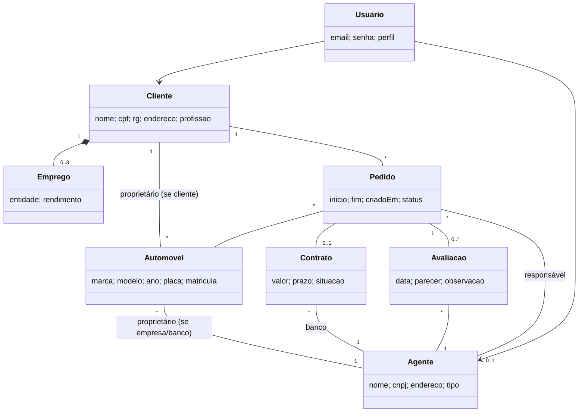
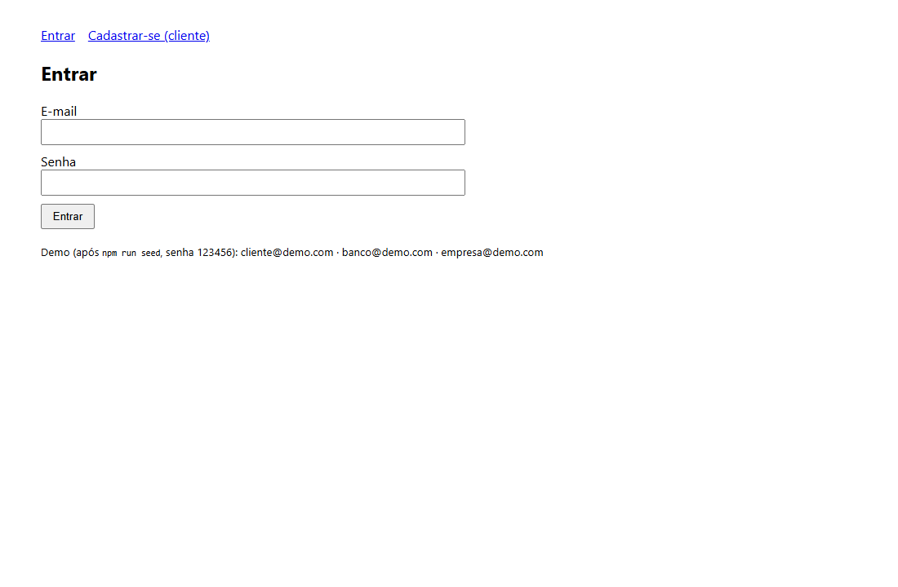
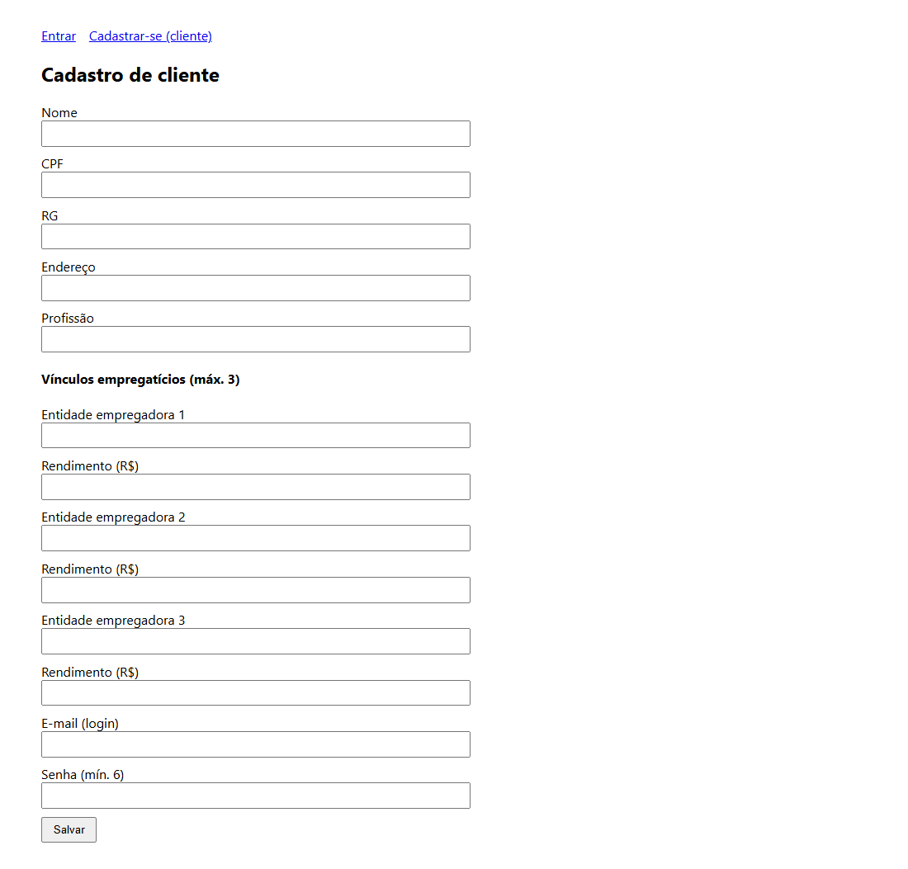
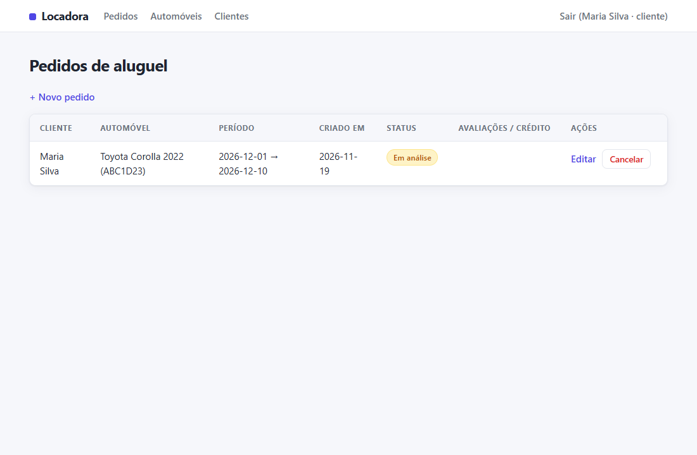
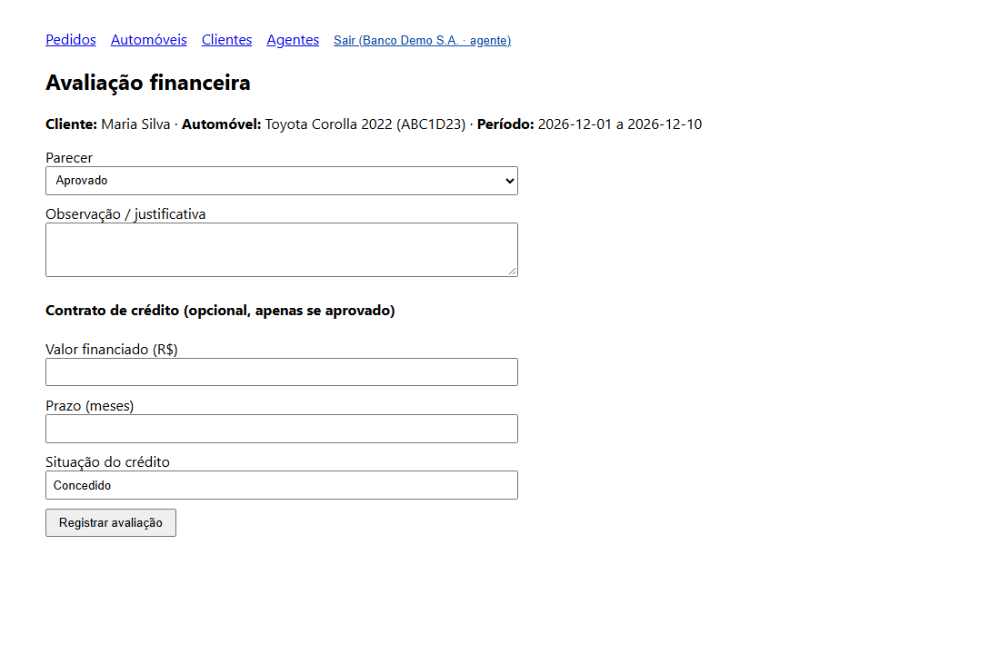

# 🚗 Sistema Web de Aluguel de Automóveis 👨‍💻

> [!NOTE]
> Sistema web para gerir pedidos de aluguel de automóveis: clientes solicitam o aluguel e agentes (empresas ou bancos) fazem a análise financeira e atualizam o status do pedido.

<table>
  <tr>
    <td width="800px">
      <div align="justify">
        Projeto da disciplina de <b>Desenvolvimento e Integração de Aplicações Web</b> (Trabalho Prático 2 - Aplicação Final). Reúne <i>cadastro de usuários, automóveis e pedidos de aluguel</i>, além da <i>avaliação financeira</i> feita por agentes e do <i>contrato de crédito</i> opcional concedido por bancos. A aplicação segue a arquitetura <b>MVC</b>, persiste os dados em <b>MongoDB</b> (acessado via RESTHeart) e foi desenvolvida em três sprints, combinando modelagem UML e implementação.
      </div>
    </td>
  </tr>
</table>

## 🚧 Status do Projeto

        

**Sprint 3 concluída** (protótipo funcional). Pendências conhecidas em [Limitações e Pendências](#-limitações-e-pendências).

---

## 📚 Índice
- [Links Úteis](#-links-úteis)
- [Sobre o Projeto](#-sobre-o-projeto)
- [Funcionalidades Principais](#-funcionalidades-principais)
- [Regras de Negócio](#-regras-de-negócio)
- [Tecnologias Utilizadas](#-tecnologias-utilizadas)
- [Arquitetura](#-arquitetura)
  - [Diagramas UML](#diagramas-uml)
  - [Evolução dos diagramas entre as sprints](#evolução-dos-diagramas-entre-as-sprints)
- [Instalação e Execução](#-instalação-e-execução)
  - [Pré-requisitos](#pré-requisitos)
  - [Variáveis de Ambiente](#-variáveis-de-ambiente)
  - [Instalação de Dependências](#-instalação-de-dependências)
  - [Inicialização do Banco de Dados (MongoDB via RESTHeart)](#-inicialização-do-banco-de-dados-mongodb-via-restheart)
  - [Como Executar a Aplicação](#-como-executar-a-aplicação)
  - [Dados de Exemplo](#-dados-de-exemplo)
- [Deploy](#-deploy)
- [Estrutura de Pastas](#-estrutura-de-pastas)
- [Demonstração](#-demonstração)
- [Qualidade de Código](#-qualidade-de-código)
- [Testes](#-testes)
- [Limitações e Pendências](#-limitações-e-pendências)
- [Documentações utilizadas](#-documentações-utilizadas)
- [Autores](#-autores)
- [Contribuição](#-contribuição)
- [Licença](#-licença)

---

## 🔗 Links Úteis
* 💻 **Repositório:** [GitHub](https://github.com/maria-brito15/locadora-TP)
* 📖 **Documentação de modelagem:** [`docs/`](./docs/README.md)
* 🌐 **Aplicação local:** <http://localhost:3000>
* 🗄️ **API REST do banco (RESTHeart):** <http://localhost:8080/locadora>

---

## 📝 Sobre o Projeto

Empresas e bancos precisam analisar a situação financeira de quem deseja alugar um automóvel antes de liberar o contrato. Este sistema centraliza esse fluxo:

- o **cliente** se cadastra, escolhe um automóvel, informa o período e acompanha o status do pedido;
- o **agente** (empresa ou banco) consulta pedidos pendentes, registra o parecer financeiro com justificativa e, quando for um banco, pode conceder um contrato de crédito;
- o pedido percorre os status **Em análise → Aprovado/Reprovado → Contrato em execução**, ou **Cancelado** pelo cliente.

O projeto tem contexto acadêmico e demonstra coerência entre requisitos, modelagem UML e código.

---

## ✨ Funcionalidades Principais

- 🔐 **Autenticação:** login/logout com senha criptografada (bcrypt) e sessão; acesso somente com cadastro prévio e perfil (cliente ou agente).
- 👤 **Clientes:** cadastro público, consulta, edição e exclusão do próprio cadastro, com CPF (11 dígitos, único), e-mail único e até 3 vínculos empregatícios com rendimentos.
- 🚘 **Automóveis:** CRUD (agentes) com proprietário cliente, empresa ou banco.
- 🏦 **Agentes:** CRUD (agentes) do tipo empresa ou banco, com login próprio.
- 📄 **Pedidos de aluguel:** o cliente cria, consulta, edita (em análise) e cancela os próprios pedidos e vê o status e as avaliações.
- 📊 **Avaliação financeira:** o agente lista pedidos pendentes e aprova ou reprova com justificativa; o status é atualizado e o agente fica registrado.
- 💳 **Contrato de crédito:** opcional na aprovação, concedido somente por agente do tipo banco (valor, prazo e situação).
- ▶️ **Execução do contrato:** o agente coloca pedidos aprovados em "Contrato em execução".

---

## 📏 Regras de Negócio

1. Apenas usuários cadastrados utilizam o sistema.
2. O cliente cria, edita, consulta e cancela somente os próprios pedidos.
3. Pedido cancelado não pode ser aprovado nem colocado em execução.
4. Apenas agentes realizam avaliações financeiras, e a avaliação registra o agente.
5. Um cliente possui no máximo 3 vínculos de empregador/rendimento.
6. Um contrato de crédito só pode ser concedido por agente do tipo banco.
7. Todo automóvel possui proprietário identificado (cliente, empresa ou banco); o proprietário (cliente ou agente) não pode ser excluído enquanto possuir automóveis, e automóvel com pedidos não pode ser excluído.
8. Alterações no modelo e nas regras são refletidas nos diagramas UML (`docs/`) e no código.

### Status do pedido

| Status | Significado |
|---|---|
| Em análise | Criado pelo cliente e aguardando avaliação |
| Aprovado | Aprovado financeiramente pelo agente |
| Reprovado | Recusado na análise financeira |
| Cancelado | Cancelado pelo cliente (permitido em "Em análise" e "Aprovado") |
| Contrato em execução | Aprovado e confirmado para execução |

Nenhum status adicional foi criado além dos sugeridos no enunciado.

---

## 🛠 Tecnologias Utilizadas

### 💻 Front-end

* **Biblioteca:** React 18
* **Linguagem:** TypeScript 5.6
* **Roteamento:** React Router 6
* **Build Tool:** Vite 5
* **Estilização:** CSS próprio, minimalista e responsivo, com tema claro/escuro automático (`frontend/src/styles.css`)

### 🖥️ Back-end

* **Linguagem/Runtime:** TypeScript 5.6 sobre Node.js 20+
* **Framework:** Express 5 (API JSON em `/api`)
* **Sessão:** express-session (cookie)
* **Autenticação:** bcryptjs (hash de senha) e sessão
* **Banco de Dados:** MongoDB 7, acessado via API REST do RESTHeart
* **Execução em desenvolvimento:** tsx

### ⚙️ Infraestrutura & DevOps

* **Containerização:** Docker Compose (MongoDB + RESTHeart)

### ✨ Qualidade

* **Lint:** ESLint 9 com typescript-eslint e @stylistic (regras de espaçamento entre instruções)

---

## 🏗 Arquitetura

A aplicação adota o padrão **MVC** com front-end React (View) separado de uma API Express (Controller e Model). O backend nunca acessa o MongoDB diretamente: todo CRUD passa pela API REST do RESTHeart por meio de um repositório genérico.

| Camada | Pasta | Responsabilidade |
|---|---|---|
| Model | `src/models.ts`, `src/restheart.ts` | Entidades, tipos, coleções e repositório genérico sobre o RESTHeart |
| View | `frontend/src/**` | Telas React (SPA) que consomem a API JSON |
| Controller | `src/controllers/*.ts`, `src/middleware.ts` | Rotas `/api`, validação, autorização por perfil e regras de negócio |

**Fluxo de dados:** React (fetch `/api`) → Express (sessão e middlewares `logado`, `soCliente`, `soAgente`) → controller → model/repositório → RESTHeart → MongoDB → resposta JSON → React.

**Decisões e trade-offs:**
- RESTHeart evita um driver/ODM no backend e expõe o MongoDB por HTTP; o custo é um serviço adicional no Docker Compose.
- Em desenvolvimento o Vite faz proxy de `/api` para o Express; em produção o Express serve `frontend/dist`.
- Autorização feita nos controllers por perfil e por posse do recurso (o cliente só mexe no que é dele).
- Sessões em memória, suficientes para o protótipo.

### Diagramas UML

Todos os modelos estão em [`docs/`](./docs/README.md) e são renderizados pelo GitHub (Mermaid).

| Diagrama | Sprint | Arquivo |
|---|---|---|
| Casos de uso | 1 | [docs/casos-de-uso.md](./docs/casos-de-uso.md) |
| Histórias de usuário e estados do pedido | 1 | [docs/historias-de-usuario.md](./docs/historias-de-usuario.md) |
| Classes | 1 | [docs/diagrama-de-classes.md](./docs/diagrama-de-classes.md) |
| Pacotes | 1 | [docs/diagrama-de-pacotes.md](./docs/diagrama-de-pacotes.md) |
| Componentes | 2 | [docs/diagrama-de-componentes.md](./docs/diagrama-de-componentes.md) |

Resumo do modelo de classes:



### Evolução dos diagramas entre as sprints

| Sprint | Alteração | Motivo |
|---|---|---|
| 1 | Casos de uso, histórias, classes e pacotes | Modelagem inicial do domínio |
| 2 | Diagramas revisados e diagrama de componentes | Feedback recebido e estrutura MVC com MongoDB |
| 3 | Front-end migrado para React (SPA) consumindo API JSON; relação `Pedido → Agente (responsável)`, caso de uso "Colocar pedido em execução" e estados do pedido | Alinhamento com a implementação final |

O histórico detalhado fica em [docs/README.md](./docs/README.md) e nos commits do repositório.

---

## 🔧 Instalação e Execução

### Pré-requisitos

* **Node.js:** versão 20 ou superior
* **Gerenciador de pacotes:** npm
* **Docker** e Docker Compose (sobem o MongoDB e o RESTHeart)

---

### 🔑 Variáveis de Ambiente

Todas são opcionais; os valores padrão funcionam com o `docker-compose.yml` do projeto. O arquivo [`.env.example`](./.env.example) lista as variáveis; a aplicação **não** carrega `.env` sozinha — exporte-as no shell (ex.: `export SESSION_SECRET=...`) ou use `node --env-file`. As credenciais `admin`/`secret` do RESTHeart são as padrão do ambiente de desenvolvimento (porta 8080 exposta apenas em `127.0.0.1`); não use em produção.

| Variável | Descrição | Padrão |
| :--- | :--- | :--- |
| `PORT` | Porta da API | `3000` |
| `SESSION_SECRET` | Segredo da sessão (**obrigatório com `NODE_ENV=production`**) | `dev-secret` |
| `RESTHEART_URL` | URL do RESTHeart | `http://localhost:8080` |
| `RESTHEART_DB` | Nome do banco (o `docker-compose.yml` só monta `/locadora`; para outro nome, altere também `mongo-mounts` no compose) | `locadora` |
| `RH_USER` / `RH_PASS` | Credenciais do RESTHeart | `admin` / `secret` |

---

### 📦 Instalação de Dependências

```bash
git clone https://github.com/maria-brito15/locadora-TP.git
cd locadora-TP
npm run install:all     # back-end (raiz) + front-end (frontend/)
```

---

### 💾 Inicialização do Banco de Dados (MongoDB via RESTHeart)

```bash
docker compose up -d
```

Isso sobe o MongoDB e o RESTHeart (porta 8080). O banco `locadora` e as coleções (`usuarios`, `clientes`, `agentes`, `automoveis`, `pedidos`, `avaliacoes`, `contratos`) são criados automaticamente quando a aplicação inicia.

---

### ⚡ Como Executar a Aplicação

Em dois terminais:

```bash
npm start        # Terminal 1: API em http://localhost:3000/api (ou npm run dev, com recarga)
npm run web      # Terminal 2: React em http://localhost:5173
```

Para servir tudo pela porta 3000 (modo produção): `npm run build` e depois `npm start`; o Express entrega `frontend/dist`.

Para parar o banco: `docker compose down`.

---

### 🌱 Dados de Exemplo

```bash
npm run seed
```

Cria dois agentes, um cliente, dois automóveis e um pedido. O comando é idempotente (não duplica os dados).

| Perfil | E-mail | Senha |
|---|---|---|
| Cliente | `cliente@demo.com` | `123456` |
| Agente (banco) | `banco@demo.com` | `123456` |
| Agente (empresa) | `empresa@demo.com` | `123456` |

> [!NOTE]
> Novos clientes se cadastram em `/registro`. Novos agentes são criados por um agente já logado, em **Agentes**.

---

## 🚀 Deploy

O projeto é um protótipo acadêmico e não foi publicado em nenhum provedor. Para simular produção localmente (Express servindo o front-end compilado):

```bash
npm run build                                  # gera frontend/dist
NODE_ENV=production SESSION_SECRET=<segredo> npm start
```

O MongoDB/RESTHeart continuam sendo iniciados com `docker compose up -d`; em um ambiente real, troque as credenciais do RESTHeart e use HTTPS.

---

## 📂 Estrutura de Pastas

```
.
├── .gitignore
├── .env.example                 # 🔑 Variáveis de ambiente (modelo).
├── README.md                    # 📘 Documentação principal.
├── docker-compose.yml           # 🐳 MongoDB + RESTHeart.
├── eslint.config.mjs            # ✨ Regras do ESLint.
├── package.json                 # 📦 Dependências e scripts.
├── tsconfig.json
│
├── /docs                        # 📚 Modelagem UML e histórias de usuário.
│   ├── README.md
│   ├── casos-de-uso.md
│   ├── historias-de-usuario.md
│   ├── diagrama-de-classes.md
│   ├── diagrama-de-pacotes.md
│   ├── diagrama-de-componentes.md
│   └── /img                     # 🖼️ Capturas de tela usadas no README.
│
├── /src                         # 🖥️ API Express (Controller e Model)
│   ├── server.ts                # 🚀 Inicialização do Express.
│   ├── middleware.ts            # 🛡️ logado, soCliente, soAgente.
│   ├── models.ts                # 🧬 Entidades e coleções.
│   ├── validacao.ts             # ✅ Helpers de validação de entrada.
│   ├── restheart.ts             # 🔌 Repositório genérico sobre o RESTHeart.
│   ├── seed.ts                  # 🌱 Dados de exemplo.
│   └── /controllers             # 🎮 auth, clientes, agentes, automoveis, pedidos.
│
├── /e2e                         # 🧪 Testes end-to-end (Playwright)
├── playwright.config.ts
│
└── /frontend                    # 💻 React + Vite (View)
    ├── index.html
    ├── vite.config.ts           # 🔁 Proxy de /api para o Express.
    └── /src
        ├── main.tsx, App.tsx    # 🚪 Entrada e rotas.
        ├── api.ts, auth.tsx     # 🔌 Cliente HTTP e contexto de login.
        ├── types.ts, styles.css
        ├── /components          # 🧱 Layout, Campo.
        └── /pages               # 📄 Login, Clientes, Agentes, Automóveis, Pedidos, Avaliar.
```

---

## 🎥 Demonstração

Fluxos principais para a apresentação:

1. **Cliente:** registrar-se → login → listar automóveis → criar pedido → consultar status → editar/cancelar.
2. **Agente:** login → filtrar pedidos "Em análise" → avaliar (aprovar/reprovar com justificativa) → opcionalmente registrar crédito (banco) → colocar pedido aprovado em execução.
3. **Regras:** tentar aprovar pedido cancelado, cadastrar 4º vínculo empregatício e conceder crédito com agente do tipo empresa (todos bloqueados).

| Tela | Captura de Tela |
| :---: | :---: |
| **Login** | **Cadastro de cliente** |
|  |  |
| **Pedidos do cliente** | **Avaliação financeira** |
|  |  |

---

## ✨ Qualidade de Código

```bash
npm run check      # verificação de tipos do back-end (tsc)
npm run lint       # ESLint
npm run lint:fix   # corrige o espaçamento automaticamente
npm run format     # Prettier
```

O ESLint usa `typescript-eslint` e `@stylistic/padding-line-between-statements`, que exige linha em branco antes de `return`, entre declarações (`const`/`let`) e estruturas de controle, e entre instruções e declarações.

## 🧪 Testes

Testes **end-to-end** com [Playwright](https://playwright.dev/) simulam usuários reais em navegador (cliente e agentes em sessões separadas). Ficam em `e2e/` e cobrem 44 cenários (24 de interface + 20 de API):

- **Cliente:** cadastro, login (com erro), senha curta, e-mail repetido, limite de 3 vínculos, edição e exclusão da conta, criar/editar/cancelar pedido, período inválido, isolamento entre clientes e bloqueio de telas de agente.
- **Agente:** aprovar com contrato de crédito, reprovar, campos de crédito só para banco, justificativa obrigatória, filtro "Em análise", CRUD de automóveis e de agentes, login do agente criado e impedimento de excluir a si mesmo.
- **API (sem navegador, `e2e/api.spec.ts`):** rotas protegidas, isolamento de pedidos/clientes (IDOR), cliente sem permissão de avaliar/executar/gerenciar agentes e automóveis, impossibilidade de forçar status, limite de 3 vínculos (cadastro e edição), validação de CPF/e-mail/tipos/datas/automóvel inexistente, avaliação financeira (agente, data, parecer, status), contrato somente por banco, pedido cancelado não aprovado/executado/editado e regras de integridade na exclusão.
- **Jornadas:** pedido de Em análise até Contrato em execução, cancelamento de pedido aprovado, pedido cancelado que não pode ser aprovado (aba desatualizada) e privacidade entre dois clientes.

Pré-requisito: `docker compose up -d`. O Playwright sobe a API e o React sozinho (ou reaproveita os que já estiverem rodando) e popula o banco com o seed.

```bash
npx playwright install chromium   # uma vez
npm run test:e2e                  # roda a suíte
npm run test:e2e:ui               # modo interativo
npx playwright show-report        # relatório HTML
```

Sem baixar o Chromium, use o Edge instalado no Windows: `PW_CHANNEL=msedge npm run test:e2e` (PowerShell: `$env:PW_CHANNEL="msedge"; npm run test:e2e`).

---

## ⚠️ Limitações e Pendências

- **Contrato de crédito:** é criado na aprovação do pedido por um agente banco e exibido no pedido; não há tela própria para editá-lo ou excluí-lo depois.
- **Disponibilidade:** não há verificação de conflito de datas entre pedidos do mesmo automóvel.
- **Validação de documentos:** CPF é validado por quantidade de dígitos e unicidade (sem dígito verificador); CNPJ, RG e placa não têm validação de formato.
- **Perfis de agente:** todo agente (empresa ou banco) pode gerenciar agentes e automóveis; a única diferença de permissão é a concessão de crédito, restrita a bancos.
- **Listagens:** o repositório lê até 1000 documentos por coleção (limite de página do RESTHeart); sem paginação.
- **Segurança:** não há token CSRF (cookie `SameSite=Lax`) nem limite de tentativas de login; o RESTHeart usa credenciais padrão de desenvolvimento.
- **Sessões em memória:** reiniciar o servidor desloga os usuários.
- **Sem painel administrativo** (opcional no enunciado).
- **Sem testes unitários** (apenas E2E).
- O primeiro agente só existe via `npm run seed`; depois disso, novos agentes são criados pela tela de Agentes.

---

## 🔗 Documentações utilizadas

* 📖 [Express](https://expressjs.com/)
* 📖 [React](https://react.dev/) e [React Router](https://reactrouter.com/)
* 📖 [Vite](https://vite.dev/guide/)
* 📖 [RESTHeart](https://restheart.org/docs/)
* 📖 [MongoDB](https://www.mongodb.com/docs/)
* 📖 [Docker](https://docs.docker.com/)
* 📖 [typescript-eslint](https://typescript-eslint.io/) e [ESLint Stylistic](https://eslint.style/)
* 📖 [Mermaid](https://mermaid.js.org/)
* 📖 [Conventional Commits](https://www.conventionalcommits.org/en/v1.0.0/)

---

## 👥 Autores

| 👤 Nome | :octocat: GitHub | 📤 E-mail |
|---------|-----------------|-----------|
| Maria Eduarda de Paula Brito | [GitHub](https://github.com/maria-brito15) | [mariaeduardadepaulabrito@gmail.com](mailto:mariaeduardadepaulabrito@gmail.com) |

---

## 🤝 Contribuição

1. Faça um `fork` do projeto.
2. Crie uma branch (`git checkout -b feature/minha-feature`).
3. Commit suas mudanças seguindo [Conventional Commits](https://www.conventionalcommits.org/en/v1.0.0/) (`git commit -m 'feat: adiciona X'`).
4. Execute `npm run check` e `npm run lint` antes do push.
5. Faça o `push` e abra um **Pull Request**.

---

## 📄 Licença

Projeto acadêmico. Defina a licença antes de publicar (ex.: MIT).

---
