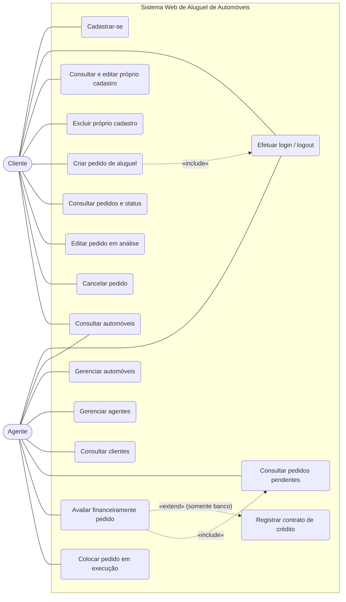

# Diagrama de Casos de Uso

## Descrição resumida

| Caso de uso | Ator | Regra principal |
|---|---|---|
| Cadastrar-se | Cliente | Até 3 vínculos empregatícios; CPF (11 dígitos) e e-mail únicos |
| Efetuar login / logout | Cliente, Agente | Apenas usuários cadastrados acessam |
| Criar / editar / cancelar pedido | Cliente | Apenas os próprios pedidos; edição só em análise |
| Consultar pedidos e status | Cliente | Vê somente os próprios pedidos e avaliações |
| Gerenciar automóveis | Agente | Proprietário obrigatório: cliente, empresa ou banco; não exclui automóvel com pedidos |
| Gerenciar agentes | Agente | Tipo empresa ou banco; não exclui agente com automóveis, avaliações ou contratos |
| Avaliar financeiramente pedido | Agente | Parecer aprovado/reprovado com justificativa; registra o agente; pedido cancelado não pode ser aprovado |
| Registrar contrato de crédito | Agente (banco) | Opcional na aprovação; apenas agente do tipo banco |
| Colocar pedido em execução | Agente | Somente pedidos aprovados |
