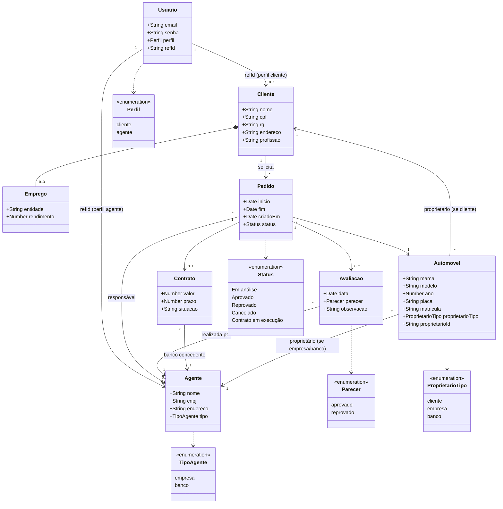

# Diagrama de Classes

## Regras de negócio refletidas no modelo

- `Cliente` possui no máximo 3 `Emprego`.
- `Contrato.bancoId` referencia somente `Agente` com `tipo = banco`.
- `Automovel` sempre possui `proprietarioTipo` e `proprietarioId`; o proprietário (`Cliente` ou `Agente`) não pode ser excluído enquanto possuir automóveis.
- `Avaliacao` sempre referencia o `Agente` que a realizou.
- `Cliente.cpf` é único e possui 11 dígitos.
- `Pedido` cancelado não pode receber `Avaliacao` aprovada nem ir para "Contrato em execução".
