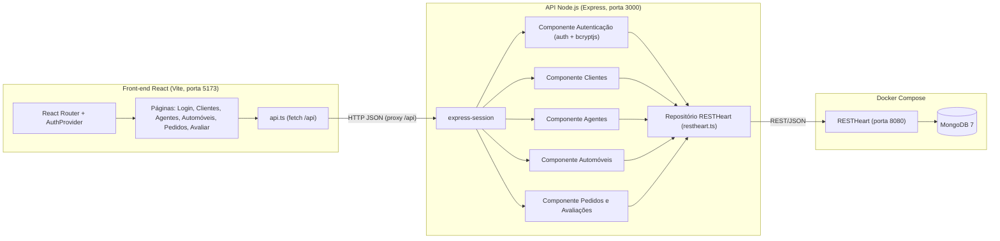

# Diagrama de Componentes

| Componente | Interface oferecida | Depende de |
|---|---|---|
| Front-end React | Telas e rotas do navegador | API `/api` |
| Autenticação | `POST /api/login`, `POST /api/logout`, `GET /api/me` | Repositório (usuários, clientes, agentes) |
| Clientes | `POST /api/registro`, `/api/clientes` | Repositório |
| Agentes | `/api/agentes` | Repositório |
| Automóveis | `/api/automoveis` | Repositório |
| Pedidos e Avaliações | `/api/pedidos`, `/api/pedidos/:id/avaliar`, `/api/pedidos/:id/executar` | Repositório |
| Repositório RESTHeart | CRUD genérico por coleção | RESTHeart / MongoDB |
