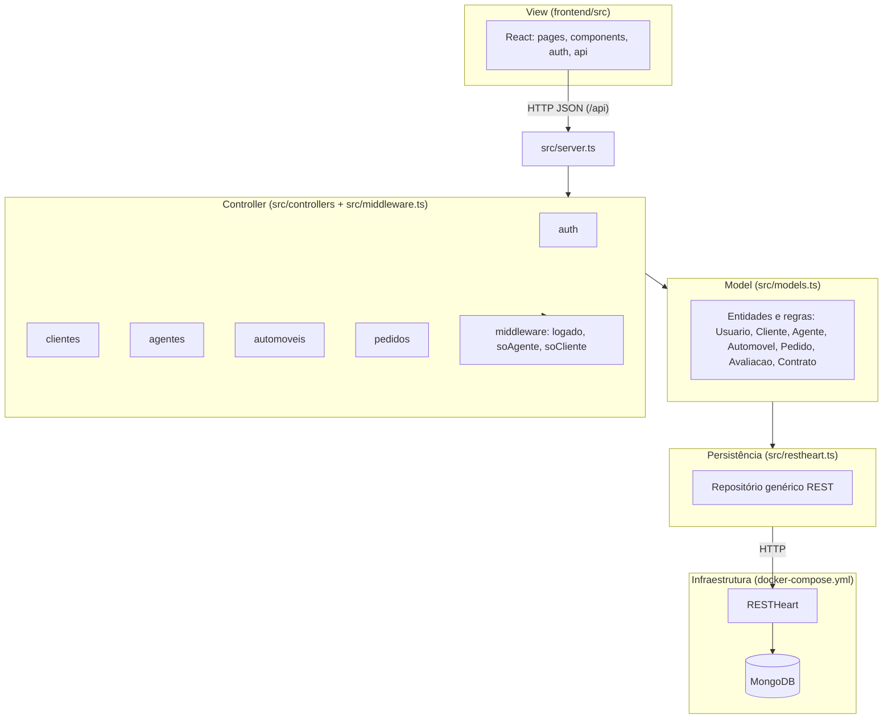

# Diagrama de Pacotes (visão lógica)

| Pacote | Responsabilidade |
|---|---|
| View | Telas React (SPA) que consomem a API JSON |
| Controller | Rotas `/api`, validação, autorização e regras de negócio |
| Model | Entidades, tipos e coleções |
| Persistência | Acesso ao MongoDB via API REST do RESTHeart |
