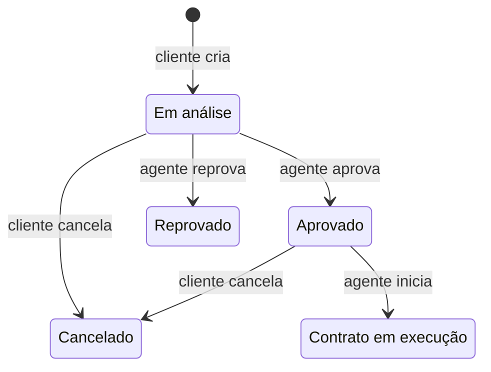

# Histórias de Usuário

## Perfil: Cliente

| ID | História | Critérios de aceite |
|---|---|---|
| HU01 | Como cliente, quero me cadastrar informando nome, CPF, RG, endereço, profissão e empregadores com rendimentos, para poder acessar o sistema. | Todos os campos obrigatórios; CPF com 11 dígitos e único; no máximo 3 vínculos; e-mail válido e único; senha com 6+ caracteres. |
| HU02 | Como cliente, quero fazer login e logout, para acessar minha área com segurança. | Credenciais inválidas exibem erro; páginas internas exigem login. |
| HU03 | Como cliente, quero consultar e editar meus dados, para mantê-los atualizados. | Só vejo e altero meu próprio cadastro. |
| HU04 | Como cliente, quero excluir meu cadastro, para encerrar minha conta. | Meus pedidos, avaliações e contratos são removidos junto; bloqueado se eu for proprietário de algum automóvel. |
| HU05 | Como cliente, quero consultar os automóveis disponíveis, para escolher qual alugar. | Lista mostra marca, modelo, ano, placa e proprietário. |
| HU06 | Como cliente, quero criar um pedido de aluguel escolhendo automóvel e período, para solicitar o aluguel. | Automóvel existente; período com datas reais (fim ≥ início); pedido nasce "Em análise" com data de criação. |
| HU07 | Como cliente, quero consultar meus pedidos e seus status, para acompanhar a análise. | Vejo status, avaliações (parecer e justificativa) e contrato de crédito, se houver. |
| HU08 | Como cliente, quero editar um pedido, para corrigir automóvel ou período. | Permitido apenas com status "Em análise" e apenas nos meus pedidos. |
| HU09 | Como cliente, quero cancelar um pedido, para desistir do aluguel. | Permitido para "Em análise" ou "Aprovado"; pedido cancelado não pode ser aprovado nem executado. |

## Perfil: Agente

| ID | História | Critérios de aceite |
|---|---|---|
| HU10 | Como agente, quero fazer login, para acessar as funções de análise. | Perfil agente habilita as telas restritas; clientes recebem acesso negado. |
| HU11 | Como agente, quero cadastrar, consultar, editar e excluir agentes (empresa ou banco), para manter os responsáveis pelas análises. | Nome, CNPJ, endereço e tipo obrigatórios; não posso excluir a mim mesmo nem agente com automóveis, avaliações ou contratos vinculados; banco com contratos não muda de tipo. |
| HU12 | Como agente, quero cadastrar, consultar, editar e excluir automóveis, para manter a frota. | Marca, modelo, ano, placa, matrícula e proprietário (cliente, empresa ou banco) obrigatórios; automóvel com pedidos não pode ser excluído. |
| HU13 | Como agente, quero consultar clientes, para apoiar a análise financeira. | Lista com dados e rendimentos de todos os clientes. |
| HU14 | Como agente, quero listar pedidos pendentes, para decidir quais analisar. | Filtro por status "Em análise". |
| HU15 | Como agente, quero aprovar ou reprovar um pedido com justificativa, para concluir a avaliação financeira. | Registra agente, data, parecer e observação; status vira "Aprovado" ou "Reprovado"; só pedidos "Em análise". |
| HU16 | Como agente de banco, quero registrar um contrato de crédito na aprovação, para financiar o aluguel. | Valor, prazo e situação; só agente do tipo banco; vinculado ao pedido. |
| HU17 | Como agente, quero colocar um pedido aprovado em execução, para iniciar o contrato. | Somente pedidos "Aprovado"; status vira "Contrato em execução". |

## Status do pedido

